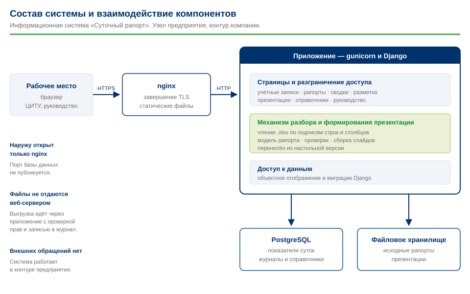
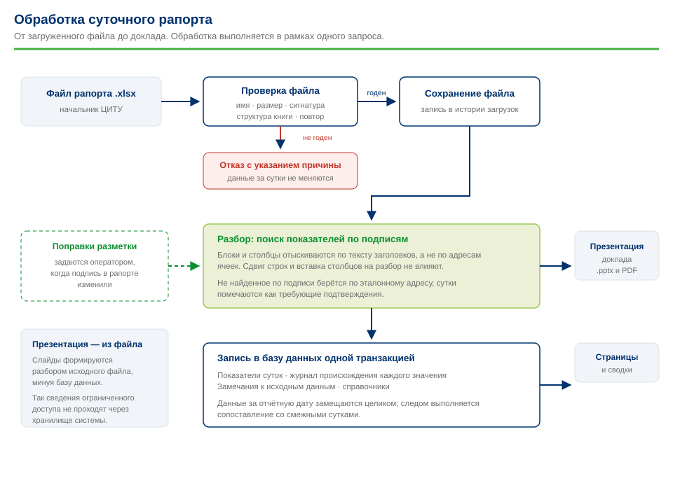

# Веб-приложение: проект системы

Документ описывает систему, которая заменит настольную программу
подготовки доклада. Здесь зафиксированы стек, модель данных, состав
страниц, права доступа и порядок развёртывания.

Это **рабочий документ разработки**: здесь фиксируются решения
и доводы за них, в том числе отвергнутые варианты. Сдаточные документы —
[описание программы](program-description.md), руководство пользователя
(раздел «Инструкция» в интерфейсе), [развёртывание](deploy.md)
и [программа испытаний](acceptance.md) — написаны официальным языком
и живут отдельно. Этот документ переписывать в тот же стиль не нужно:
он нужен для контроля наполненности и принятых решений.

Редакция от 15.09.2026.

Схемы включены и в описание программы; исходники — в каталоге `img`.



## 1. Что меняется

| | Настольная программа | Веб-приложение |
|---|---|---|
| Где работает | на рабочем месте оператора | на сервере компании |
| Кто пользуется | оператор ЦИТУ | ЦИТУ и руководство |
| Что видно | одна презентация за одни сутки | история, сводки за период, дашборд |
| Данные | живут в файле Excel и исчезают | накапливаются в базе |
| Интерфейс | окно Tkinter | браузер |

Настольная версия **снимается с эксплуатации** после запуска веб-приложения
и до тех пор остаётся работоспособной в своём отдельном репозитории:
пока веб не умеет всё, что умеет окно, у ЦИТУ должен оставаться
рабочий инструмент.

### Что переиспользуется

Разделение на слои, сделанное в настольной версии, окупается здесь.
Пакеты `domain`, `excel` и `render` не знают ни про Tkinter, ни про
Django — окно было лишь одной «входной дверью» к движку. Django
становится второй:

```
загрузка .xlsx → excel.reader → DailyReport → запись в БД
                                          └→ render.slides → .pptx
```

Движок перенесён в этот проект копией, без `gui/`. Переписывать заново
разбор, проверенный на реальных рапортах и устойчивый к сдвигу шаблона,
означало бы выбросить самую дорогую часть работы. Дальше он развивается
здесь.

## 2. Пользователи и роли

**У каждого работника личная учётная запись.** Общих входов в системе
нет: иначе журнал действий бессмыслен — непонятно, кто загрузил или
заменил данные за дату.

| Роль | Должность | Что может |
|---|---|---|
| Администратор | сопровождение системы | всё, включая справочники, пользователей и повторный разбор архива |
| Руководство | главный инженер и выше | дашборд, карточки суток, сводки, скачивание презентаций и выгрузок |
| Работник промысла | начальник ЦИТУ и его заместитель | загрузка и перезагрузка рапортов, работа с замечаниями, плюс всё, что доступно руководству |

Роли — группы Django, права проверяются в представлениях. Учётные записи
заводит администратор вручную через панель управления: самостоятельной
регистрации нет. Выданный пароль пользователь обязан сменить при первом
входе.

Роль «Работник промысла» должна быть выдана **минимум двум людям**:
иначе в первый же отпуск или больничный начальника ЦИТУ загружать данные
станет некому и в истории появится дыра.

## 3. Стек и обоснование

| Слой | Решение | Почему |
|---|---|---|
| Язык | Python 3.12 | тот же, что у движка разбора |
| Каркас | Django 5.2 | ORM, миграции, аутентификация и админка справочников — всё, что иначе пришлось бы писать руками |
| База | PostgreSQL 16 | оконные функции и усечение дат для сводок, надёжные транзакции при перезагрузке суток |
| Страницы | шаблоны Django, отрисовка на сервере | без Node и сборки фронтенда: один артефакт развёртывания |
| Графики | Chart.js, файл в репозитории | интерактивные графики без обращения к внешним CDN |
| Веб-сервер | gunicorn за nginx | статика отдаётся nginx, приложение — gunicorn |
| Запуск | Docker Compose | воспроизводимое развёртывание |
| Проверки | pytest, pytest-django, pycodestyle | ограничение строки 88 знаков, как в настольной версии |

### Решения, которые стоит обосновать

**Почему не SPA (React/Vue).** Отдельный фронтенд — это сборка Node,
второй артефакт развёртывания, свой цикл обновления зависимостей и
отдельный разговор с ИБ про пакеты npm. Выигрыш — плавность интерфейса,
который открывают несколько человек несколько раз в день. Не окупается.

**Почему не FastAPI.** Здесь нужны ORM, миграции, аутентификация, права
и админка справочников. В Django это есть из коробки.

**Почему PostgreSQL и в разработке.** Сводки опираются на усечение дат
и оконные функции — ровно то, где диалекты расходятся сильнее всего.
Разница в цене — один контейнер, разница в риске — велика.

**Почему в итоге вообще без очереди.** Изначально был заведён
Django-Q2 — он берёт уже имеющуюся базу и не тянет Redis. Но за всё
время разработки задачи для него так и не нашлось: всё, что делает
система, укладывается в секунды одного запроса, а массовая загрузка
архива и так делается командой из терминала. Очередь убрана; когда
появится работа по расписанию, вернуть её — полдня.

**Почему API пока нет.** Страницы отрисовываются на сервере, данные
для графиков уходят в разметку страницы — отдельный интерфейс им
не нужен. API оправдывается потребителем, а его нет: снаружи данные
никто не запрашивал. Построенный заранее, он был бы спроектирован
вслепую и стал бы второй поверхностью, которую нужно защищать
и версионировать. Кроме того, API — это канал наружу для коммерческой
тайны, и его появление меняет разговор с ИБ: сейчас сильный довод
в том, что данные не покидают контур вовсе. Возвращаться к вопросу —
когда появится названный потребитель (BI, хранилище предприятия,
смежная система). Начинать тогда с одной точки на чтение под той же
сессионной аутентификацией; DRF нужен, когда появятся запись, фильтры
и сторонние клиенты. Ту же потребность заметно дешевле закрывает
выгрузка сводки в Excel.

## 4. Объём данных

Замерено на реальном рапорте:

| Что | Строк за сутки |
|---|---|
| Скважины в списках (простой, бездействие, ВСП, запуски) | 141 |
| Журнал происхождения показателей | 65 |
| Фонд и добыча по месторождениям | 32 |
| Резервуары, ППД, качество, газ, бурение, очистные устройства | 24 |
| Замечания к данным | 5 |
| **Итого** | **≈ 270** |

Около **100 тысяч строк в год**, порядка миллиона за десять лет.
Партиционирование, витрины и архивирование не нужны: схема
нормализуется как положено, сводки считаются запросами на лету.

Исходные файлы `.xlsx` — около 280 КБ, примерно 100 МБ в год.

## 5. Модель данных




Принцип: таблицы повторяют структуры из `rvp_report/domain/model.py`
один в один. Тогда код перекладывания разобранного рапорта в базу
остаётся очевидным, а не превращается в отдельную логику.

### Справочники (`catalog`)

```
Field            месторождение: имя, короткое имя, признак действующего
FieldAlias       синонимы написания: «С.Ошк» → «Северо-Ошкотынское»
Well             скважина: номер, месторождение, категория
InjectionObject  объект ППД: ЦПС, УПСВ-2, УПСВ-3, ДНС Мусюршор
MeteringNode     узел учёта: ОУУН ЦПС, СИКН-438, СИКН-301, СИКН-391
Tank             резервуар: ЦПС РВС-5000 и прочие
Contractor       буровой подрядчик: ОУБР, БКЕ
DowntimeReason   причина простоя: код и название
```

`FieldAlias` нужен не для красоты: в одном и том же рапорте
месторождение называется «Северо-Ошкотынское» в добыче и «С.Ошк»
в бурении. Без таблицы синонимов это две разные сущности, и история
по месторождению развалится. Справочники пополняются при загрузке
по принципу «найти или создать», новые записи помечаются для проверки
администратором.

### Суточные данные (`reports`)

```
Report                одни сутки: дата (уникальна), погода, статус
  ProductionDaily     1:1 — планы, факт, потенциал, НСЖ, нарастающие итоги
  DeliveryDaily       1:1 — сдача на ПСП и в «Транснефть»
  PowerDaily          1:1 — выработка, число агрегатов
  HseDaily            1:1 — число происшествий и обращений (без текста)
  FieldProductionDaily  добыча по месторождениям
  StockDaily            фонд по месторождениям и итог
  WellDaily             скважина за сутки: категория, потери, причина, даты
  RampUpDaily           вывод на режим
  InjectionDaily        закачка по объектам ППД
  TankDaily             резервуарный парк
  QualityDaily          качество товарной нефти по узлам учёта
  GasDaily              добыча / утилизация / факел
  DrillingDaily         скважины в бурении
  PiggingDaily          пуски очистных устройств
  DieselStockDaily      остатки дизтоплива
  DowntimeBreakdownDaily  разбивка простоя по причинам
  LoadIssue             замечания к качеству данных
  ProvenanceEntry       откуда взят каждый показатель
```

`WellDaily` — центральная таблица истории. Категория (`downtime`,
`idle`, `vsp`, `startup`) отличает списки друг от друга, а связь
со справочником `Well` открывает то, чего в Excel нет в принципе:
накопленные потери по конкретной скважине и повторные отказы.

### История загрузок

```
Upload   файл, его SHA-256, размер, кто и когда загрузил,
         результат разбора, признак действующей загрузки
```

`Report` на дату один, `Upload` на дату может быть несколько: рапорт
присылают с исправлениями. Загрузка **идемпотентна по дате** — в одной
транзакции удаляются суточные строки и записываются новые, предыдущая
загрузка теряет признак действующей, но остаётся в истории вместе
с файлом.

Хранение исходных файлов даёт важную возможность: когда разбор
улучшается, команда `manage.py reparse --from 2026-08-01` перечитывает
архив и обновляет базу, не тревожа ЦИТУ просьбой прислать файлы заново.

### Проверяемость каждой цифры

Правило «на слайде не должно быть ни одной цифры, которую нельзя
проверить по рапорту» переносится в веб без послаблений:

- `ProvenanceEntry` хранит происхождение каждого показателя — адрес
  ячейки, диапазон суммирования или формулу расчёта;
- на карточке суток работает та же кнопка «Откуда цифры»;
- расчётные величины помечаются «расч.» и раскрываются формулой.

Для сводок за период добавляется своё правило. **Сводка обязана
показывать, за сколько суток из скольких есть данные.** Сумма за месяц,
собранная из 27 суток вместо 31, — не месячная сумма, и молча выдавать
её за неё нельзя. Пропущенные даты перечисляются рядом с итогом.

Нарастающие итоги, посчитанные в самом рапорте, хранятся отдельно от
сумм по суткам. Расхождение между ними — не ошибка приложения, а
диагностика исходных данных, и её надо видеть.

### Персональные данные

Обращения в здравпункт содержат ФИО, год рождения и диагноз —
специальная категория персональных данных по 152-ФЗ. **Текст обращений
в базу не попадает никогда**: в `HseDaily` пишется только количество.

**Уточнение по итогам разбора августа.** Сначала считалось, что
персональные данные сосредоточены в графе здравпункта. Это оказалось
неверно: в рапорте за 23.08.2026 в графе «Описание происшествия»
записано «обратился монтажник» с фамилией, инициалами и медицинскими
подробностями — та же специальная категория. Поэтому свободный текст
происшествия в базу тоже не попадает: в `IncidentDaily` хранятся только
обезличенные признаки — ДЗО, месторождение, область события и тип.

Если такие сведения окажутся в базе, система становится информационной
системой персональных данных со всеми требованиями к аттестации,
и проект остановится на согласовании. Ограничение закреплено тестами:
отдельно для сводки ПБиОТ и отдельно для происшествий.

**Открытый вопрос, требующий решения заказчика.** Сам файл рапорта
хранится целиком — он нужен и для повторного разбора после улучшения
парсера, и для сборки презентации. Значит, персональные данные лежат
в хранилище файлов, пусть и не в базе. Варианты: принять это и защищать
хранилище (ограничение доступа, шифрование, срок хранения) либо
отказаться от хранения исходников, потеряв повторный разбор. Решение
принимает владелец данных, не разработчик.

## 6. Состав страниц

```
/                        Дашборд
/reports/                Суточные рапорты — список
/reports/<дата>/         Карточка суток
/reports/<дата>/sources/ Откуда цифры
/reports/upload/         Загрузка рапорта             [работник промысла]
/summary/                Сводки за период
/wells/<номер>/          История скважины
/quality/                Качество исходных данных
/guide/                  Инструкция
/accounts/login/         Вход
/admin/                  Справочники и пользователи   [администратор]
```

**Дашборд** — главная страница для руководства. Показатели за последние
сутки теми же плитками, что на втором слайде, и графики за выбранный
период: добыча против планов СГ и БП, потери с разбивкой на простой,
бездействие и внутрисменные, утилизация газа, закачка ППД против режима,
выполнение бизнес-плана нарастающим итогом. Плюс светофор качества
данных: пропущенные сутки и замечания.

**Карточка суток** повторяет одиннадцать согласованных блоков доклада,
но как веб-страницу, и даёт кнопки «Скачать презентацию» и «Скачать PDF».
Презентация остаётся нужной: доклад главному инженеру идёт по слайдам,
а не по экрану — это подтверждено заказчиком.

Презентация собирается **из исходного файла рапорта**, а не из базы.
Так слайды заведомо совпадают с тем, что проверял начальник ЦИТУ,
и подробности происшествия, нужные на слайде, не проходят через
хранилище. База остаётся источником для сводок и дашборда, файл —
для презентации.

**Загрузка** — перетаскивание файла и протокол разбора: что прочитано,
какие замечания, что записано. Если данные за эту дату уже были, протокол
прямо говорит, что они заменены, и называет прежнюю загрузку — она
сохраняется в истории.

Разбор выполняется **в самом запросе**, а не фоновой задачей. Он занимает
несколько секунд, а загрузка происходит раз в сутки: очередь добавила бы
опрос состояния и новый способ сломаться — «задача зависла», — ничего
не дав взамен. Django-Q остаётся для длинных действий: повторного разбора
всего архива после улучшения парсера.

**Сводки** — неделя, месяц, квартал, полугодие, год и произвольный
период. Разрезы: по месторождениям, по причинам простоя, по скважинам.
Выгрузка в Excel и PDF.

**История скважины** — то, чего в исходной таблице нет вообще: когда
останавливалась, по какой причине, сколько потеряно суммарно, когда
ремонтировалась и вставала ли снова после ремонта.

**Качество исходных данных** — все замечания за период и их динамика.
Побочный, но полезный результат: видно, где в рапорте систематически
ошибаются, и это можно вернуть в ЦИТУ.

**Инструкция** — руководство по всем разделам, по одному на каждую
роль, плюс раздел «Чего система не делает». Лежит шаблоном
в репозитории, а не отдельным файлом PDF, который поддерживают руками:
так она меняется тем же коммитом, что и описываемая страница,
и разойтись они не могут. Кнопка печати даёт из неё PDF, если нужен
именно файл для рассылки. Разделы показываются все и всем — человек
может совмещать должности, а прятать половину инструкции значит
заставлять спрашивать.

### Страницы ошибок

Без своих шаблонов Django отдаёт строку по-английски: «Not Found»,
«Server Error (500)». Человеку, который в восемь утра готовит доклад
к девяти, такая страница не говорит ни что случилось, ни успеет ли он.
Поэтому страницы свои и отвечают на оба вопроса.

| Код | Когда | Что на странице |
|---|---|---|
| 400 | испорченная ссылка | что делать и кому сообщить |
| 403 | страница не для этой должности | под кем выполнен вход, к кому идти за правами |
| 403 CSRF | сеанс истёк, пока форма была открыта | что ничего не потеряно и повтор безопасен |
| 404 | нет такой страницы или таких суток | причина, если она написана для человека |
| 500 | сбой приложения | что данные целы и что сбой записан в журнал |
| 502 | приложение не отвечает | что идёт перезапуск; страница обновляется сама |

Три решения, которые стоит помнить:

- **404 показывает причину только там, где она написана для человека.**
  `get_object_or_404` подставляет английский служебный текст с именем
  модели; свои пояснения помечаются исключением `config.errors.Missing`,
  и на страницу попадают только они.
- **500 не наследует общий шаблон.** Django рисует её без запроса
  и без процессоров контекста, поэтому она самостоятельна: оформление
  внутри файла, ни статики, ни картинок. Если сломалась сама раздача
  статики, страница об этом всё равно отрисуется.
- **502 отдаёт nginx, а не приложение** — до Django дело не доходит.
  Файл лежит в `deploy/errors/` и подключается томом.

Посмотреть их в разработке:
`DJANGO_DEBUG=0 python manage.py runserver --insecure`. При включённом
`DEBUG` Django показывает свою отладочную страницу, а не эти.

## 7. Фоновых задач нет

Очередь была предусмотрена проектом и заведена (Django-Q2 на базе
PostgreSQL), но за всё время разработки ей не нашлось работы, и
13.09.2026 она убрана из проекта вместе с зависимостью.

| Работа | Как делается |
|---|---|
| Разбор загруженного рапорта и запись в базу | в самом запросе, ~3 с |
| Сборка презентации | в самом запросе по кнопке, ~5 с |
| Массовая загрузка архива | команда `manage.py load_reports` |
| Повторный разбор после улучшения разбора | та же команда |
| Сверка с соседними сутками | при загрузке, плюс команда `crosscheck` |
| Резервная копия базы | `cron` на сервере, вне приложения |

Довод против очереди оказался сильнее довода за. Загрузка бывает **раз
в сутки** и делает её человек, который сидит и ждёт результата: очередь
дала бы ему опрос состояния вместо ответа и новый способ сломаться —
«задача зависла». Массовая загрузка архива — работа администратора
из командной строки, ей веб-запрос не нужен вовсе.

Если однажды понадобится рассылка по расписанию (например, письмо
о том, что рапорт к восьми утра не загружен), очередь вернётся — вместе
с задачей, которая её оправдывает.

## 8. Аутентификация и права

Собственная аутентификация Django: вход по логину и паролю, сессия,
обязательная смена выданного пароля при первом входе, блокировка после
серии неудачных попыток. Единого входа по домену не делаем — наличие
Active Directory в компании не подтверждено, а заявки на создание
пользователей администратор обрабатывает вручную через панель
управления.

Права проверяются в представлениях через группы. Загрузка и замена
данных — только «Работник промысла» и «Администратор». Просмотр — всем
аутентифицированным. Анонимного доступа нет ни к одной странице.

Ведётся журнал действий: кто загрузил файл, кто заменил данные за дату,
кто скачал презентацию или выгрузку. Записи журнала из интерфейса
не удаляются.

## 9. Информационная безопасность

Аргументы для согласования:

- **Нет обращений в интернет.** Библиотеки ставятся из локального
  зеркала, Chart.js лежит в репозитории, внешние CDN не используются.
- **Нет исполняемого кода в данных.** Читается `.xlsx`, создаётся
  `.pptx` — форматы без макросов. Загружаемые файлы проверяются по
  расширению, сигнатуре и размеру.
- **Персональные данные не хранятся** — см. раздел 5.
- **Гриф «Коммерческая тайна»** на страницах, в презентациях и выгрузках.
- **Доступ по HTTPS**, cookie сессии — `Secure`, `HttpOnly`, `SameSite=Lax`.
- **Файлы не отдаются nginx напрямую**: скачивание идёт через
  представление с проверкой прав и записью в журнал.
- **Исходные рапорты не попадают в репозиторий** — они в `.gitignore`.
  Репозиторий копируется и клонируется, и это единственный канал,
  где данные разъезжаются незаметно.
- **Открытый код** без обфускации, пригодный для ревью.
- **Резервные копии** базы и хранилища файлов по расписанию,
  с проверкой восстановления.

## 10. Развёртывание

```
nginx        TLS, статика, проксирование
web          gunicorn + Django
db           PostgreSQL 16
```

Тома: база, загруженные рапорты, собранные презентации, статика.
Настройки — через переменные окружения, секреты в `.env` вне
репозитория.

Порядок по средам:

1. **Внешний VPS компании** — разработка и опытная эксплуатация.
   Машину предоставляет заказчик, данные размещаются по его решению.
2. **Документация по развёртыванию** во внутреннем контуре: подготовка
   узла, зеркало пакетов, сертификат, первый запуск, создание
   администратора, загрузка архива, резервное копирование.
3. **Внутренний сервер компании** — перенос силами заказчика,
   приёмка, вывод настольной версии из эксплуатации.

CI/CD: `pycodestyle` и `pytest` на каждый push, сборка образа на теге,
развёртывание на VPS. Для внутреннего сервера тот же конвейер
описывается в документации.

## 11. Этапы работ

| Этап | Содержание | Оценка |
|---|---|---|
| 1 | Каркас: Django, Docker Compose, PostgreSQL, вход, роли, CI | 3 дня |
| 2 | Справочники и модель данных, миграции, админка | 4 дня |
| 3 | Загрузка рапорта: очередь, разбор, запись, идемпотентность | 4 дня |
| 4 | Массовая загрузка архива и повторный разбор | 2 дня |
| 5 | Список рапортов и карточка суток, «Откуда цифры» | 4 дня |
| 6 | Редактор разметки — см. [layout-editor.md](layout-editor.md) | 5 дней |
| 7 | Выдача презентации и PDF из веба | 2 дня |
| 8 | Сводки за период с контролем полноты данных | 5 дней |
| 9 | Межсуточные проверки данных | 2 дня |
| 10 | Дашборд руководства с графиками | 4 дня |
| 11 | История скважины, качество исходных данных | 3 дня |
| 12 | Развёртывание, документация, приёмка | 4 дня |
| | **Итого** | **42 дня** |

Оценка — чистое время разработки, без согласований, ожидания доступов
и обучения пользователей.

Массовая загрузка архива поднята на четвёртый этап: заказчик может
предоставить рапорты за целый месяц, и все последующие разделы —
сводки, дашборд, история скважин — разрабатываются и проверяются
на настоящей истории, а не на трёх сутках. Это заметно повышает
вероятность поймать проблемы до сдачи.

### Два этапа, добавленные после разбора архива за август

**Редактор разметки (этап 6).** Архив за август вскрыл два изменения
шаблона за один месяц. Сопровождать систему будет один человек, и без
редактора каждая правка ЦИТУ будет упираться в него. Устройство,
границы применимости и порядок работы описаны отдельно:
[layout-editor.md](layout-editor.md).

**Межсуточные проверки (этап 9).** Рапорт за 21.08.2026 показал фонд
«в работе» 329 скважин вместо обычных 253 и простой 11 скважин вместо
84–87 — при самой низкой добыче за месяц. Внутри суток он
непротиворечив: список, ИТОГО и таблица фонда согласованы между собой,
и ни одна из нынешних сверок его не поймала. Такие случаи видны только
при сравнении с соседними сутками, а это возможно лишь при наличии
истории. Проверяются резкие изменения фонда, потерь, добычи и закачки
относительно предыдущих суток и среднего за две недели.

## 12. Вопросы заказчику

### Отвеченные

1. **Браузеры.** Яндекс, Chrome, Mozilla в обычных версиях. Ограничений
   на современную вёрстку нет.
2. **Просмотр с телефона.** Возможен, поэтому вёрстка адаптивная.
   Проверка мобильного отображения внесена в программу испытаний.
3. **Регламент доклада.** Сводка должна быть готова к совещанию
   в 09:00 ежедневно. Это окно обязательной работоспособности.
4. **Почтовый сервер.** SMTP у компании есть, доступа к нему нет.
   Решение: писем система не отправляет вовсе, пароль назначает
   администратор вручную. Настройки почты из проекта убраны
   13–15.09.2026 — мёртвая конфигурация создавала впечатление
   работающей рассылки.
5. **Откуда берутся данные для файла.** Начальник ЦИТУ сводит
   отдельные сводки от множества операторов. Значит, форма ввода
   в браузере перенесла бы ту же ручную работу и выигрыша не дала бы;
   ввод остаётся файлом.
6. **Что произошло 21.08.2026.** Реальное событие: массовый
   перезапуск 76 скважин после техограничения. Ловится только
   межсуточными проверками — довод в их пользу подтверждён.

### Открытые

1. **Как определяется факел.** За все 31 сутки августа и в июле
   утилизация газа равна 95,5135 % с точностью до пятого знака, при том
   что добыча газа менялась на 4 %. Факел = добыча × 0,0448646, коэффициент
   постоянен. Значит, факел не меряется, а считается по нормативу, и цифра
   «утилизация 95,51 %» не несёт суточной информации. В сводках за период
   показывать надо добычу и факел в тоннах, а не процент. Вопрос задан ЦИТУ.
2. **Срок хранения исходных файлов рапортов.** Файлы хранятся
   целиком ради повторного разбора и сборки презентации, а в них есть
   персональные данные. Сколько их держать и кто принимает решение —
   вопрос к владельцу данных, не технический.
3. Прежние вопросы из настольной версии остаются: расхождение по ППД
   (факт закачки вдвое выше режима на трёх объектах пять дней подряд)
   и расшифровка сокращений ЦОМ, СГ, НСЖ, ВСП, ПКИОС.
